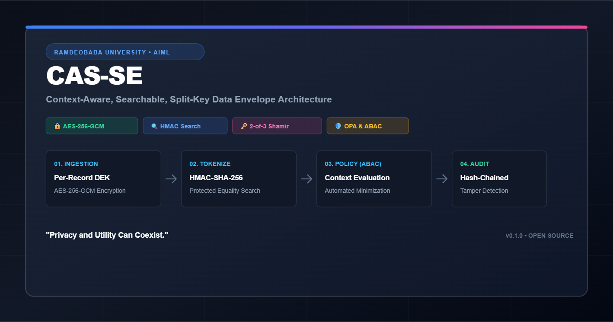

<div align="center">
  
# CAS-SE: Context-Aware, Searchable, Split-Key Data Envelope
A Privacy-Preserving Data-Governance & Access-Control Architecture for Sensitive ML Datasets


[](https://www.python.org/downloads/)
[](https://opensource.org/licenses/MIT)
[](https://fastapi.tiangolo.com/)
[](https://www.postgresql.org/)

*Developed by the B.Tech AIML Project Team (Ramdeobaba University, Nagpur)*  
**Guide:** Prof. Sonam Meshram  
**Team:** Nikhil Singh (37) • Soham Kharabe (23) • Karunya Paliwal (14) • Gaurang Daware (17) • Prajwal Khandekar (26)

</div>

> **CAS-SE** is a privacy-preserving data-governance architecture designed to be integrated into an organization's existing database and storage infrastructure.
>
> **It is not a standalone application or a database replacement.** It is a middleware layer comprising schema overlays, policy engines, and cryptographic primitives that intercept data ingestion, search, and access operations to enforce **least-privilege envelope encryption**, **context-aware authorization**, **protected search**, **data minimization**, and **tamper-evident auditing** for sensitive ML datasets.

The `frontend/` folder is an optional reference dashboard for demonstrations
only. Client deployments integrate the `backend/` middleware into their own
application and identity stack; CAS-SE is not delivered as a web application.

---

## 🏛️ Architecture & Integration Model

An adopting organization deploys CAS-SE as a middleware tier between their application/pipeline services and their existing database/storage tiers:

```
┌──────────────────────────────────────────────────────────────┐
│                  ORGANIZATION'S APPLICATION LAYER            │
│              (their existing web app, ML pipeline, etc.)     │
└─────────────────────────┬────────────────────────────────────┘
                          │  REST API calls
                          ▼
┌──────────────────────────────────────────────────────────────┐
│                     CAS-SE MIDDLEWARE LAYER                  │
│  ┌──────────┐ ┌──────────┐ ┌──────────┐ ┌───────────────┐   │
│  │ Envelope │ │ Policy   │ │  Audit   │ │     Key       │   │
│  │ Service  │ │ Engine   │ │ Service  │ │   Service     │   │
│  │          │ │  (OPA)   │ │ (Chain)  │ │  (Envelope    │   │
│  │ encrypt, │ │ context- │ │ tamper-  │ │  encryption,  │   │
│  │ decrypt, │ │ aware    │ │ evident  │ │  rotation,    │   │
│  │ search,  │ │ ABAC     │ │ HMAC     │ │  split-key)   │   │
│  │ minimize │ │          │ │ chain    │ │               │   │
│  └────┬─────┘ └────┬─────┘ └────┬─────┘ └───────┬───────┘   │
│       │             │            │                │           │
│  ┌────┴─────────────┴────────────┴────────────────┴───────┐  │
│  │              DATABASE ADAPTER INTERFACE                 │  │
│  │     (SQLAlchemy-based — works with any supported DB)    │  │
│  └────┬───────────────────────────────────────────┬───────┘  │
└───────┼───────────────────────────────────────────┼──────────┘
        │                                           │
        ▼                                           ▼
┌───────────────────┐                 ┌──────────────────────┐
│  ORGANIZATION'S   │                 │   ORGANIZATION'S     │
│  PostgreSQL /     │                 │   Object Storage     │
│  Compatible RDBMS │                 │   (MinIO/S3/Azure/   │
│                   │                 │    GCS)              │
└───────────────────┘                 └──────────────────────┘
```

---

## 🛡️Core Principles

1. **Envelope Encryption**: Payloads are never stored in plaintext in object storage and never stored as raw blobs in the database. Each record is encrypted with a fresh random 32-byte Data Encryption Key (DEK) via AES-256-GCM. The DEK is wrapped by a Key Encryption Key (KEK).
2. **Pluggable Adapter Interfaces**: Standard Python Protocols allow organizations to plug in their existing infrastructure:
   - `StorageAdapter`: MinIO, AWS S3, Azure Blob, GCS, or Local Filesystem.
   - `KeyServiceAdapter`: AWS KMS, HashiCorp Vault, HSM, EnvVar (demo), or Split-Key (2-of-3 Shamir secret sharing simulation).
   - `IdentityAdapter`: BuiltIn (JWT + Argon2), LDAP, OIDC, or SAML.
3. **Protected Equality Search**: HMAC-SHA-256 tokenization prevents indexing or querying sensitive terms in plaintext.
4. **Context-Aware Policy Engine (OPA)**: Open Policy Agent with Rego policies evaluates requester identity, role, purpose, dataset scope, and job approval status with fail-closed (deny-by-default) semantics.
5. **Data Minimization**: Decrypted payloads are tailored to the requester's authorized view (`metadata_only`, `masked_image`, `feature_only`, `raw_image`).
6. **Tamper-Evident Hash-Chained Audit Trail**: Append-only audit records chained via HMAC-SHA-256 enable cryptographic detection of tampering or deletion.

---

## ⚙️Pluggable Adapters

### Storage Adapter (`app.adapters.storage.StorageAdapter`)
```python
class StorageAdapter(Protocol):
    def put_object(self, key: str, data: bytes) -> str: ...
    def get_object(self, key: str) -> bytes: ...
    def delete_object(self, key: str) -> None: ...
    def health_check(self) -> bool: ...
```
- `MinIOAdapter`: S3-compatible backend using `boto3`.
- `LocalFileAdapter`: Filesystem backend for local testing and isolated development.

### Key Service Adapter (`app.adapters.key_service.KeyServiceAdapter`)
```python
class KeyServiceAdapter(Protocol):
    def get_current_kek(self) -> tuple[bytes, int]: ...
    def get_kek_by_version(self, version: int) -> bytes: ...
    def rotate_kek(self) -> tuple[bytes, int]: ...
```
- `EnvVarKeyService`: Environment-variable driven KEK versioning.
- `SplitKeyService`: Academic 2-of-3 Shamir Secret Sharing simulation.

### Identity Adapter (`app.adapters.identity.IdentityAdapter`)
```python
class IdentityAdapter(Protocol):
    def resolve_user(self, token: str) -> CASUser: ...
    def get_user_role(self, user_id: UUID) -> str: ...
```
- `BuiltInIdentity`: Reference Argon2 password hashing and short-lived JWT access tokens with refresh token rotation.

---

## 📂Directory Structure

```text
CAS/
├── backend/
│   ├── alembic/              # Database migration overlay
│   ├── app/
│   │   ├── adapters/         # Pluggable backend adapters (Storage, Key, Identity)
│   │   ├── api/              # REST API route handlers
│   │   ├── core/             # Configuration, settings
│   │   ├── db/               # SQLAlchemy engine & session factory
│   │   ├── models/           # SQLAlchemy ORM schema overlay models
│   │   ├── policy/           # OPA client and policy evaluators
│   │   ├── schemas/          # Pydantic validation schemas
│   │   ├── services/         # Cryptography, envelope ingestion, audit trail
│   │   └── workers/          # Celery background workers
│   ├── tests/                # Unit and integration test suite
│   ├── Dockerfile            # Container build for API and Worker
│   ├── pyproject.toml        # Ruff, Mypy, and Pytest configuration
│   └── requirements.txt      # Python dependencies
├── docker/                   # Docker environment helpers
├── docs/                     # Architecture and integration guides
├── evaluation_results/       # Empirical benchmark reports & SVG charts
├── frontend/                 # Reference Governance & Access Dashboard (React 19 + TypeScript)
│   ├── e2e/                  # Playwright End-to-End test suite
│   ├── src/components/       # 11 Double-bezel governance views
│   └── Dockerfile            # Container build for reference dashboard
├── opa/
│   └── policies/cas_se/      # Rego access-control policies
├── scripts/
│   ├── run_benchmarks.py     # Privacy vs. utility benchmark experiment runner
│   └── seed_demo_data.py     # Rich demo database seeder (all 5 roles + personas)
├── docker-compose.yml        # Multi-service reference orchestration
├── BUILD_SEQUENCE.md         # Phased execution plan & verification logs
└── prd.md                    # Product Requirements Document
```

---

## ⚡Quick Start (Development)

### 1. Environment Configuration
Copy the sample environment file:
```bash
cp .env.example .env
```
Ensure you generate secure keys for your local test environment:
```bash
# Generate 32-byte base64 KEK
python -c "import base64,os; print(base64.b64encode(os.urandom(32)).decode())"

# Generate 64-char hex keys for JWT, HMAC Index, and Audit Chain
python -c "import secrets; print(secrets.token_hex(32))"
```

### 2. Seed Demo Data & Run Benchmarks
Populate the database with demo accounts for all 5 roles, policies, and envelopes:
```bash
python scripts/seed_demo_data.py
```

Run empirical privacy vs utility benchmark experiments (generates SVG charts in `evaluation_results/`):
```bash
python scripts/run_benchmarks.py
```

### 3. Run with Docker Compose
```bash
docker compose up --build
```
This boots:
- `cas-se-api` on port `8000`
- `cas-se-dashboard` (optional reference demonstration UI) on port `3000`
- `cas-se-opa` on port `8181`
- `cas-se-worker` (Celery background worker)
- `cas-postgres` on port `5432`
- `cas-minio` on ports `9000` (API) & `9001` (Console)
- `cas-redis` on port `6379`

### 4. Verify Health & Telemetry
```bash
curl http://localhost:8000/health
# {"status":"ok","service":"CAS-SE","version":"0.1.0"}

curl http://localhost:8000/metrics
# {"status":"healthy","envelopes_total":3,"audit_events_total":4,...}
```

---

## 🧪Testing & Quality Assurance

Run backend pytest suite (93 tests covering crypto, OPA, ML jobs, audit chain, anomalies, benchmarks):
```bash
pytest backend/tests/ -v
```

Lint and format checks:
```bash
ruff check backend/ scripts/
ruff format --check backend/ scripts/
```

Run frontend Playwright E2E tests:
```bash
cd frontend
npm run test:e2e
```

---


## 🎥 **Watch the video demonstration:** 
[Meet CAS-SE.mp4](./Meet%20CAS-SE.mp4)

## 📜 Known Academic Limitations & Ethics

- **Equality-pattern leakage**: HMAC tokens disclose whether indexed terms are identical.
- **Academic Simulation**: Split-key Shamir recovery is a software prototype, not a hardware-backed HSM/KMS.
- **Synthetic Datasets**: Only synthetic or approved non-sensitive public datasets (Fashion-MNIST, CIFAR-10) are used for testing.
